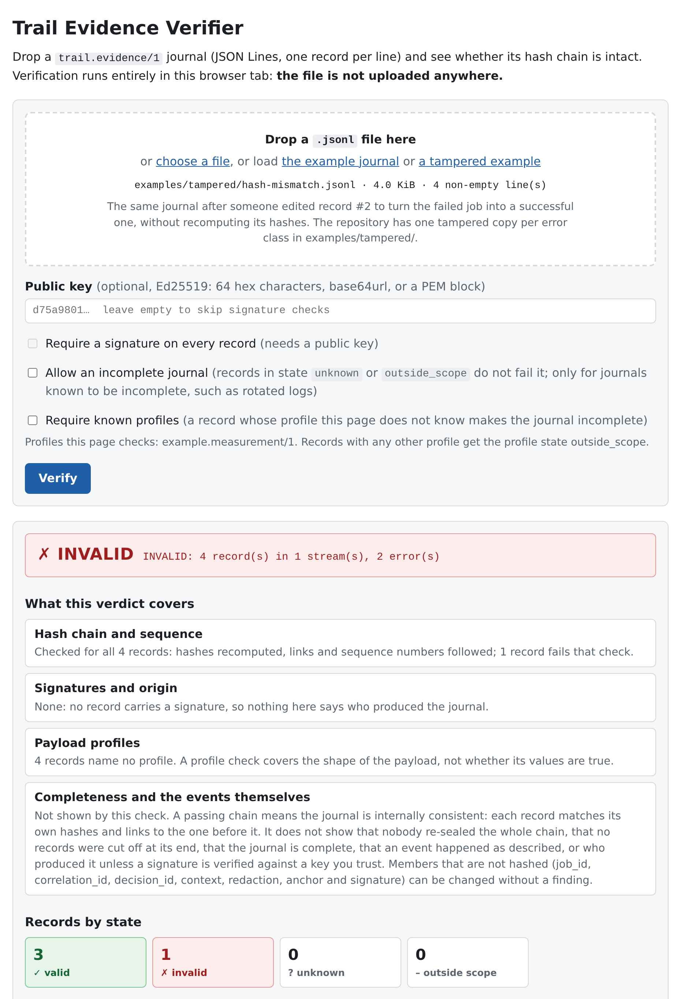
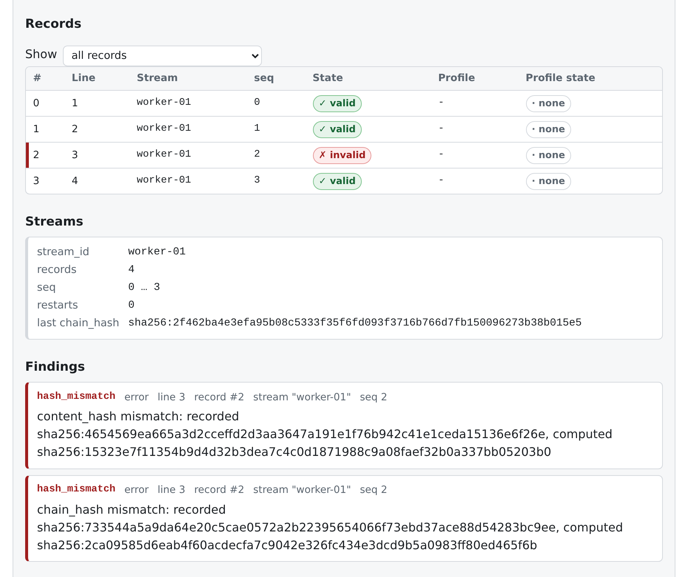

<p align="center">
  
</p>

<h1 align="center">Trail Evidence</h1>

**Status: v0.2.1, released 2026-11-07. The format may still change before
1.0; changes are listed in [CHANGELOG.md](CHANGELOG.md).**

**Is this event journal intact?** Drop a `.jsonl` journal on the browser
verifier, or run one command, and get a verdict: `valid`, `invalid` or
`incomplete`, with the first record that breaks the chain, the line it is on
and the recorded versus the recomputed hash. The same check exists in Go,
Python and JavaScript, and all three agree on every test vector.

Trail Evidence is the record format behind that check: one JSON object per
event, chained to the previous one by a hash and optionally signed. Any
program can write it; today [TrailTransfer](https://github.com/RainerGewalt/trailtransfer)
and [TrailSource](https://github.com/RainerGewalt/trailsource) do. The
verifier does not need to know what produced the journal.

## Try in the browser

```
https://rainergewalt.github.io/trail-evidence/
```



*The tampered example in the browser verifier: one edited record turns the
verdict to `invalid`.*

Drop a `.jsonl` journal on the page, optionally paste the producer's
Ed25519 public key (hex, base64url or PEM), and read the verdict, the state
and profile state of every record (colour, symbol and text), counters per
state, the findings with line, stream and `seq`, and the last `chain_hash`
of every stream. The verdict is `valid`, `invalid` or `incomplete`; an
incomplete journal is shown as its own, non-green verdict and fails unless
you tick "Allow an incomplete journal". "Load the example journal" shows a passing journal; "load a tampered
example" shows the same journal after one record was edited.



*Further down on the same page: record #2 on line 3 is `invalid`, and each
finding names the recorded and the recomputed hash.*

Nothing is uploaded. The page is plain HTML, CSS and JavaScript without a
build step or external scripts, hashing uses the browser's WebCrypto, and
the only requests it makes are for the two bundled example journals. The
profile registry ships with the page as `web/profiles.js`.
Signature checks need Ed25519 in WebCrypto (current Chrome, Firefox and
Safari); where it is missing, signatures are reported as not checked rather
than as failed.

`.github/workflows/pages.yml` publishes the page from `web/` on every push
to `main` that touches it. Locally: `python3 -m http.server -d web`.

## What a record is

A Trail Evidence Record is one JSON object that describes one event a system
wants to be able to prove later, chained to the previous record by a hash
and optionally signed. A journal is a JSON Lines file of such records. This
repository is the shared contract for that record: the specification, a JSON
Schema, test vectors, a registry of payload profiles, and verifiers in Go,
Python and JavaScript that produce identical reports.

The systems around the Trail ecosystem each keep some kind of evidence: a
transfer worker writes a job journal, a source bridge emits envelopes with
an audit block, a broker logs access decisions, an ML pipeline stores run
records. One record shape means one verifier for all of them.
`producer.kind` says where a record came from, `event_type` what happened,
`payload` carries the domain data unchanged, and `profile` names the schema
of that payload, which the producer defines and registers in
[`profiles/`](profiles/README.md). Producer kinds: `transfer-worker`, `source-bridge`, `broker`,
`ml-pipeline`, `persistence`, `other`. Two producers emit this format
today: [TrailTransfer](https://github.com/RainerGewalt/trailtransfer)
0.1.x writes its job journal as `trail.evidence/1` (still with the integer
`seq` of format 0.1, which 0.x verifiers accept with a notice), and
[TrailSource](https://github.com/RainerGewalt/trailsource) 0.1.x writes
format 0.2. TrailMQ does not
emit it today. `SPEC.md` section 8 describes the mapping for each kind.

## Install

Three ways, all with the same verifier and the same results.

**Prebuilt binary.** Each release carries archives for Linux, macOS and
Windows on amd64 and arm64, each with the binary, `LICENSE` and `SPEC.md`,
plus `checksums.txt`:

```bash
V=0.2.1
curl -LO https://github.com/RainerGewalt/trail-evidence/releases/download/v$V/trail-evidence_${V}_linux_amd64.tar.gz
curl -LO https://github.com/RainerGewalt/trail-evidence/releases/download/v$V/checksums.txt
sha256sum --ignore-missing -c checksums.txt
tar -xzf trail-evidence_${V}_linux_amd64.tar.gz trail-evidence
./trail-evidence version
```

Other targets: replace `linux_amd64` with `linux_arm64`, `darwin_amd64`,
`darwin_arm64`, `windows_amd64` or `windows_arm64` (Windows archives are
`.zip`). The binaries are not code-signed; macOS may need
`xattr -d com.apple.quarantine trail-evidence` after a browser download.

**Go** (1.22 or newer). The module lives in the subdirectory `go/`:

```bash
go install github.com/RainerGewalt/trail-evidence/go/cmd/trail-evidence@latest
```

**Python** (3.9 or newer, no dependencies). The command is
`trail-evidence-py`, so that it does not shadow the Go binary:

```bash
pip install trail-evidence
# the development state on main:
pip install "git+https://github.com/RainerGewalt/trail-evidence#subdirectory=python"
```

From a checkout, without installing: `cd go && go run ./cmd/trail-evidence …`
or `cd python && python3 -m trail_evidence …`.

## Verify a journal

The examples run from a clone of this repository, because they use its
`examples/` and `testdata/`. With a release archive the binary sits in the
unpacked folder: call it as `./trail-evidence`, or put it on your `PATH`.

```bash
trail-evidence verify examples/transfer-worker.jsonl
# VALID: 4 record(s) in 1 stream(s), hash chain intact

trail-evidence verify examples/tampered/seq-mismatch.jsonl
# INVALID: 3 record(s) in 1 stream(s), 1 error(s)
#   error   seq_mismatch      record #2 (line 3, stream "worker-01", seq 3): seq 3, expected 2: prev_hash links to the record with seq 1, so no record can be missing in between

trail-evidence verify examples/tampered/seq-gap.jsonl          # exit code 3
# INCOMPLETE: 3 record(s) in 1 stream(s), no invalid record, 1 unknown
#   notice  seq_gap           record #2 (line 3, stream "worker-01", seq 3): seq 3 after seq 1, and prev_hash sha256:… does not link to the last checked record: its predecessor is not in this journal

trail-evidence verify rotated-2026-11-02.jsonl --allow-incomplete   # a log known to start mid-stream
# INCOMPLETE (allowed): …

trail-evidence verify testdata/streams/signed.jsonl \
    --pubkey testdata/keys/test-ed25519.pub --require-signatures
# VALID: 3 record(s) in 1 stream(s), hash chain intact, 3 signed record(s), 3 signature(s) verified
```

Every record gets a state:

| State | Meaning |
|---|---|
| `valid` | Every check ran and passed: schema, `content_hash`, `chain_hash`, link to the predecessor, `seq`, the profile if known, the signature if signed and a key was given. |
| `invalid` | A check failed: `schema_invalid`, `hash_mismatch`, `chain_break`, `seq_mismatch`, `signature_invalid` or `profile_invalid`. |
| `unknown` | The record's own hashes are correct, but its predecessor is not in the file (a gap, or a journal that starts in the middle of a stream): `seq_gap`. The next record that links to it is valid relative to it (`after_unknown`). |
| `outside_scope` | The record names another format or major version (`trail.evidence/2`, `acme.audit/1`) and is not checked; the chain continues with the last checked record. |

and the journal a verdict:

| Verdict | When | Exit code |
|---|---|---|
| `valid` | every record is `valid` | 0 |
| `invalid` | at least one record is `invalid` | 1 |
| `incomplete` | no record is `invalid`, but at least one is `unknown` or `outside_scope` | 3 |

`incomplete` fails by default, because a record deleted from the middle of a
journal leads there. `--allow-incomplete` accepts it (exit code 0) for
journals known to be incomplete, such as rotated logs or excerpts. A profile
the verifier does not know leaves the payload unchecked (profile state
`outside_scope`, notice `profile_unknown`) but does not change the verdict;
`--require-known-profiles` makes such records count as incomplete, and
`--allow-incomplete` does not accept those. Exit code 2 is a usage or I/O
error.

`--json` prints the full report, including `verdict` and `results` with the
state and profile state of every record. `trail-evidence hash record.json`
recomputes the hashes of a single record and prints the canonical forms and
the record's state on its own; `trail-evidence profiles` lists the profiles
the verifier knows. `trail-evidence-py` takes the same arguments for
`verify`, `hash` and `profiles`; it has no `version` command
(`pip show trail-evidence` shows the installed version).

`verify` recomputes every hash and follows every link. The verdict `valid`
means no record in the file was altered, removed or reordered relative to
the others. It does not mean the payloads are true, that the clock was right
(`time.source` says what the producer knew about that), or that nobody
rewrote the whole file: for that you need signatures (`--pubkey`) or an
external anchor of the latest `chain_hash`. `SPEC.md` section 6.6 lists these
limits.

[`examples/tampered/`](examples/tampered/README.md) has one manipulated
journal per error class (`hash_mismatch`, `chain_break`, `seq_mismatch`,
`signature_invalid`) and two manipulations that leave the journal
`incomplete`, with the output to expect, including the case where a
rewritten journal passes without a key and fails with one.

## Produce records

```json
{
  "schema": "trail.evidence/1",
  "producer": {"kind": "transfer-worker", "id": "worker-01", "version": "0.3.1"},
  "stream_id": "worker-01",
  "seq": "7",
  "prev_hash": "sha256:…",
  "event_type": "transfer.job.result",
  "time": {"recorded_at": "2026-11-02T06:00:12.500Z", "source": "system"},
  "actor": {"auth": "self-declared", "id": "alice"},
  "policy": {"id": "archive-policy", "version": "7", "hash": "sha256:…", "status": "approved", "kind": "transfer-policy"},
  "job_id": "job-1001",
  "payload": {"action": "copy", "source": "sftp://…", "target": "s3://…", "status": "ok"},
  "content_hash": "sha256:…",
  "chain_hash": "sha256:…",
  "signature": {"alg": "ed25519", "key_id": "ed25519:…", "sig": "…"}
}
```

| Member | Hashed | Purpose |
|---|---|---|
| `schema` | core | `trail.evidence/1`; major version in the name |
| `producer` | core | `kind`, `id`, `version` of the producing instance |
| `stream_id`, `seq`, `prev_hash` | core | one hash chain per stream; `seq` is a decimal string (`"0"` to `"18446744073709551615"`) that counts by 1, `prev_hash` links to the previous `chain_hash` |
| `event_type` | core | `<domain>.<noun>.<verb>`, e.g. `mqtt.decision.deny` |
| `time` | core | `recorded_at` (sealing time, required), `occurred_at`, `read_at`, `source` |
| `actor` | core | `auth` class (`broker-authenticated`, `self-declared`, `operator-token`, `none`), `id`, `roles` |
| `policy` | core | `id`, `version`, `hash` of the rule or recipe that governed the event; `status`, `kind` |
| `payload` | via `content_hash` | the domain data, any JSON |
| `profile` | core | `<name>/<major>` of the profile that defines `payload`; optional |
| `content_hash` | core | SHA-256 over the RFC 8785 canonical payload |
| `chain_hash` | — | SHA-256 over the canonical core; what the next record links to and what a signature covers |
| `chain_restart`, `anchor_hash` | core | mark a new segment and point at the last known hash of the old one |
| `signature` | no | Ed25519 over the `chain_hash` string, base64url |
| `correlation_id`, `job_id`, `decision_id` | no | cross references |
| `context` | no | informational; evidence-relevant facts belong in `payload` |
| `redaction` | no | which payload fields were masked before hashing, and how |
| `anchor` | no | where this `chain_hash` was anchored externally (`trailmq`, `tsa`, `worm`, `other`) |

Hashing: everything is SHA-256 over RFC 8785 (JCS) bytes, written as
`sha256:` plus 64 lowercase hex characters. Genesis `prev_hash` is 64
zeros. The finding classes a verifier reports are defined in `SPEC.md`
section 6.2: the errors `schema_invalid`, `hash_mismatch`, `chain_break`,
`seq_mismatch`, `signature_invalid`, `profile_invalid`, and the notices
`seq_gap`, `outside_scope`, `profile_unknown`, `restart`,
`after_unknown`, `legacy_integer_seq` and `number_precision`. Severities
are fixed per class; the verdict decides whether a journal passes.

`seq` is a string so that it survives JCS, which treats numbers as IEEE-754
doubles, and parsers that do the same. A JSON number as `seq` (format 0.1)
is still accepted during 0.x and reported as `legacy_integer_seq`; from 1.0
it is `schema_invalid`.

Numbers in `payload`: JCS applies ES6 number semantics, so every number is
an IEEE-754 double. Integers outside ±2^53 must be sent as strings, and
floats whose exact decimal form matters should be. Otherwise
`9007199254740993` canonicalises to `9007199254740992`, and `verify`
reports a `number_precision` notice for the record.

Profiles: a producer defines the payload of its records as a profile,
`profiles/<name>/<major>.schema.json` with example payloads and a journal
written by its own implementation ([`profiles/README.md`](profiles/README.md)).
A record with `"profile":"<name>/<major>"` has its payload checked against
that schema; the profile state is `valid`, `invalid`, `outside_scope` (the
verifier does not know the profile) or `none`. Profile schemas check
required members and types only and allow other members, because minor
versions of a profile only add members. The registry has one test profile,
`example.measurement/1`.

Reason codes: when a record explains an outcome (why a job failed, why a
publish was denied), put a code from
[`docs/REASON_CODES.md`](docs/REASON_CODES.md) into `payload.reason_code`,
for example `transfer.policy_violation` or `mqtt.acl_role_not_in_topic_scope`. The
catalog is documentation; verifiers do not check it.

Go:

```go
import "github.com/RainerGewalt/trail-evidence/go/evidence"

r := evidence.Record{
    Producer:  evidence.Producer{Kind: evidence.ProducerTransferWorker, ID: "worker-01", Version: "0.3.1"},
    StreamID:  "worker-01",
    Seq:       next, // uint64, written as the decimal string "7"
    EventType: "transfer.job.result",
    Time:      evidence.Time{RecordedAt: now.UTC().Format("2006-01-02T15:04:05.000Z"), Source: evidence.TimeSourceSystem},
    Actor:     evidence.Actor{Auth: evidence.AuthSelfDeclared, ID: "alice"},
    Policy:    evidence.NoPolicy,
    Payload:   payloadJSON,
}
if err := evidence.Seal(&r, prevChainHash); err != nil { /* ... */ }
if err := evidence.Sign(&r, privateKey, ""); err != nil { /* ... */ }
line, _ := json.Marshal(&r) // append line + "\n" to the journal

rep := evidence.VerifyStream(file, evidence.Options{PublicKey: pub})
fmt.Println(rep.Summary(), rep.Verdict, rep.ExitCode())
for _, res := range rep.Results {
    fmt.Println(res.Index, res.State, res.ProfileState)
}
```

Python:

```python
from trail_evidence import seal, sign, verify_stream, GENESIS_HASH, NO_POLICY

record = {
    "producer": {"kind": "ml-pipeline", "id": "run-7f3a", "version": "1.4.0"},
    "stream_id": "run-7f3a", "seq": "0", "event_type": "ml.run.completed",
    "time": {"recorded_at": "2026-11-02T09:42:10.000Z", "source": "system"},
    "actor": {"auth": "operator-token", "id": "ml-ops"},
    "policy": NO_POLICY,
    "payload": {"metrics": {"dice": "0.9132"}, "reason_code": "ml.metrics_accepted"},
}
seal(record, GENESIS_HASH)
sign(record, seed_bytes)            # optional
with open("journal.jsonl") as fh:
    report = verify_stream(fh, public_key_bytes)
print(report.summary(), report.verdict, report.exit_code())
print([r.state for r in report.results])
```

`seal()` accepts `seq` as an int or a decimal string and writes the string.
`examples/` has one verifiable journal per producer kind.

## GitHub Action

Verify journals in CI. The step fails when any journal is `invalid`, or
`incomplete` without `allow-incomplete`, with the verifier's exit code (1 or
3).

```yaml
- uses: RainerGewalt/trail-evidence@v0.2.1
  with:
    journal: evidence/*.jsonl
```

With signatures and the outputs:

```yaml
- id: evidence
  uses: RainerGewalt/trail-evidence@v0.2.1
  with:
    journal: evidence/**/*.jsonl
    pubkey: keys/producer.pub
    require-signatures: true
- run: echo "${{ steps.evidence.outputs.records }} records, verdict ${{ steps.evidence.outputs.verdict }}"
```

For rotated logs or excerpts, which start in the middle of a stream:

```yaml
- uses: RainerGewalt/trail-evidence@v0.2.1
  with:
    journal: logs/evidence-*.jsonl
    allow-incomplete: true
```

| Input | Default | Meaning |
|---|---|---|
| `journal` | required | Path or glob, relative to the workspace; several patterns separated by spaces. `**` needs bash 4 or newer on the runner. |
| `pubkey` | empty | Ed25519 public key as 64 hex characters, or a path to a hex or PEM file. Without it signatures are counted, not checked. |
| `require-signatures` | `false` | Treat unsigned records as `signature_invalid`. Needs `pubkey`. |
| `allow-incomplete` | `false` | Accept the verdict `incomplete` (records `unknown` or `outside_scope`). Only for journals known to be incomplete. |
| `require-known-profiles` | `false` | Records with a profile the verifier does not know make the journal `incomplete`; `allow-incomplete` does not accept those. |
| `version` | the action's ref | Verifier version to install, e.g. `v0.2.0`. |

| Output | Meaning |
|---|---|
| `verdict` | `invalid` if any journal is invalid, else `incomplete` if any is incomplete (also when allowed), else `valid` |
| `records` | number of records over all journals |
| `errors` | number of findings with severity error (invalid records) over all journals |

The action installs the verifier that matches its own tag with
`go install github.com/RainerGewalt/trail-evidence/go/cmd/trail-evidence@<tag>`
and falls back to the release archive, checked against `checksums.txt`.
Referenced by branch, commit or as `uses: ./`, it builds the verifier from
its own checkout. It writes a table with one row per journal (verdict,
records, invalid, unknown, outside scope, errors, notices, signed) to the
job summary and an annotation per error finding. It needs `jq`, which GitHub-hosted runners
have; `.github/workflows/self-test.yml` runs it on Linux, macOS and Windows.
To read the outputs of a failing run, set `continue-on-error: true` on the
step.

## For producers

A project whose producer writes `trail.evidence/1` can say so with a badge:

```markdown
[](https://github.com/RainerGewalt/trail-evidence)
```

A project may show it when its producer reproduces every vector in
`testdata/vectors.json` byte for byte (producer conformance, see below). It
must also have checked a journal written by that producer with the
reference verifier (`trail-evidence verify`, no errors) at the format
version the badge names. The badge states format compatibility, not that
the recorded events are true.

Worth doing beyond that: define your payload as a profile and register it
([`profiles/README.md`](profiles/README.md)); put `payload.reason_code` on
refused, failed and degraded outcomes; sign records and publish the public
key; run the GitHub Action on journals your tests produce, with
`require-known-profiles: true` once your profile is registered.

## Conformance

`SPEC.md` section 10 makes the test data the conformance criterion. A
producer conforms when it reproduces every vector in `testdata/vectors.json`
byte for byte. A verifier conforms when it does that, reports the expected
notices, errors and state per vector, reports exactly the findings and the
state and profile state of every record listed in
`testdata/streams/expected.json` for every case, with its verdict and exit
code (some with `--allow-incomplete` or `--require-known-profiles`), and
handles the profiles in `profiles/`. Three cases are mandatory by name: the
integer 2^53+1 (canonicalises to `9007199254740992`, notice
`number_precision`), member sorting by UTF-16 code units (U+1F680 before
U+FF01), and `seq` arithmetic beyond 2^53 and at 2^64 - 1.

To check another implementation, give `scripts/conformance.sh` the command
that runs it:

```bash
scripts/conformance.sh /path/to/your-verifier
# ok   genesis-minimal
# …
# ok   jcs-edge-cases  [mandatory: integer 2^53+1 -> 9007199254740992 with number_precision notice; member order by UTF-16 code units]
# …
# ok   seq-decimal.jsonl  [mandatory: seq compared as integers beyond 2^53 and up to 2^64 - 1]
# …
# conformant: 21 vectors and 29 stream cases of trail.evidence/1, format 0.2 (suite v0.2.0)
```

The command must offer `hash <record.json>` (prints `payload_jcs`,
`content_hash`, `core_jcs`, `chain_hash`, `state`, `profile_state` and, if
the record has findings on its own, `findings` with `class` and `severity`)
and `verify <journal.jsonl> [--pubkey <file>] [--require-signatures]
[--allow-incomplete] [--require-known-profiles] --json` (prints `ok`,
`verdict`, `records`, `restarts`, `findings` with `index` and `class`, and
`results` with `state` and `profile_state`; exit 0 when ok, 1 for invalid,
3 for incomplete), like the reference CLI. The script needs only `python3`. The Go,
Python and JavaScript implementations in this repository pass it in CI.

## Spec

- [`SPEC.md`](SPEC.md): the normative specification, including the
  verification algorithm, its limits and conformance.
- [`schema/trail-evidence-1.schema.json`](schema/trail-evidence-1.schema.json):
  JSON Schema 2020-12 for the record.
- [`profiles/README.md`](profiles/README.md): the profile registry and how
  a producer submits a profile.
- [`docs/REASON_CODES.md`](docs/REASON_CODES.md) and
  [`schema/reason-codes.json`](schema/reason-codes.json): the reason code
  catalog, with its own schema.
- [`docs/RELEASING.md`](docs/RELEASING.md): how a release is cut.

```
SPEC.md                         normative specification
schema/                         record schema; reason code catalog and its schema
profiles/                       profile registry: <name>/<major>.schema.json, examples, journal
docs/                           reason code catalog, release procedure
go/                             Go module github.com/RainerGewalt/trail-evidence/go
  evidence/                       package: Seal, Sign, CheckRecord, VerifyStream; embedded profiles
  cmd/trail-evidence/             CLI: verify, hash, profiles, vectors, version
python/trail_evidence/          Python package and CLI (trail-evidence-py), profiles as package data
web/                            browser verifier (static page); verify.js, profiles.js, test/run.mjs
action.yml                      GitHub Action (composite)
testdata/vectors.json           canonicalisation and hashing vectors (generated by Go)
testdata/streams/               journals with the findings a verifier must report
testdata/keys/                  the public TEST key used by signed vectors
examples/                       one verifiable journal per producer kind
examples/tampered/              one manipulated journal per error class
scripts/crosscheck.sh           Go, Python and JavaScript must produce identical reports
scripts/conformance.sh          run any verifier against the conformance suite
scripts/validate_schema.py      JSON Schema validation of journals and profile payloads
scripts/profiles.py             check the profile registry, regenerate the verifiers' copies
scripts/reason_codes.py         check the reason code catalog, regenerate its tables
```

Development:

```bash
cd go && go build ./... && go test ./... && cd ..
cd python && python3 -m unittest discover -s tests && cd ..
node web/test/run.mjs
scripts/crosscheck.sh
scripts/validate_schema.py --vectors testdata/vectors.json examples/*.jsonl examples/tampered/*.jsonl profiles/*/*.journal.jsonl
scripts/profiles.py --check
scripts/reason_codes.py --check
```

Vectors, fixtures, examples and the journal of the test profile are
generated: edit `go/internal/vectors/vectors.go`, run `cd go && go run
./internal/gentestdata -root ..`, and commit the result. After changing a
profile schema, run `scripts/profiles.py --write`. `go test` fails when the committed files
are out of date. See [CONTRIBUTING.md](CONTRIBUTING.md) and
[CHANGELOG.md](CHANGELOG.md).

## Feedback and support

Tried it? An
[evaluation report](https://github.com/RainerGewalt/trail-evidence/issues/new?template=evaluation-report.yml)
helps more than anything else: what you ran, whether it worked, and what got
in the way. A first run that failed is as useful as one that worked. Bugs can
also go into a plain issue. Vulnerabilities, including problems in the hashing or
signature logic, go to [SECURITY.md](SECURITY.md), not to a public issue.

Support is best effort: issues are read and answered, but there is no
guaranteed response time, no support contract, no SLA and no paid support.

## License

Apache License 2.0, see [LICENSE](LICENSE). Copyright 2026 Florian Przybylak.
